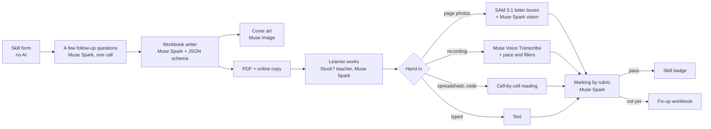

# Learn with AI

**A patient AI teacher for any skill, at the price of a workbook.**

A learner tells the AI who they are and what they want to learn. The AI writes a workbook just for them, helps whenever they are stuck, checks the finished work and awards a skill badge. If the work is not there yet, it writes a short fix-up workbook for the gaps. One engine serves **309 listed skills**, and any other safe skill a learner names, for every age: from three-year-olds learning to hold a pencil to job-seekers learning Power BI, gym trainers planning client programmes, and grandparents learning to spot a UPI scam.

Built by [GrowthGoal](https://growthgoal.in), an Indian learning shop, for the **Meta Global AI Developer Hackathon 2026**, on the **Meta Model API**: Muse Spark, Muse Image, SAM 3.1 and Muse Voice Transcribe.

Live: **https://growthgoal.in/learn** (free while the hackathon runs)

---

## Why

Good teaching is patient, personal and costly. In India, 27% of students take private coaching, and a city family spends close to ₹10,000 a year on it for one higher-secondary student ([NSS education survey 2025](https://news.careers360.com/27-of-students-rely-on-private-coaching-urban-participation-higher-cms-education-survey-2025/amp)). A human teacher who explains the same thing for the fortieth time gets tired. An AI teacher does not.

Learn with AI keeps what makes a workbook work (doing the task yourself, on paper or on screen) and adds what a workbook never had: one written for you, help at the moment you are stuck, and an honest check at the end.

## How it works

1. **Tell the AI about you.** Each skill has its own short form (written once by Muse Spark, so filling it costs nothing): who is learning, their goal, where they are now, what goes wrong, minutes a day, what they love, and anything else. Muse Spark then reads it once and asks at most a few follow-up questions, in English, Hindi or Hinglish, before it writes.
   Don't see your skill? Name it. One Muse Spark call checks it is safe and legal to teach (it turns down weapons, hacking, cheating, licensed work like surgery, and suggests something close), gives it a name, a shelf, a price band and its own form. Asked again, it costs nothing.
2. **Get your workbook.** Muse Spark writes it to a strict JSON schema: chapters, short lessons, worked examples, graded tasks, a final task, a daily plan, and a rubric for every task. Muse Image draws a cover for this learner. It prints as a PDF (dotted trace rows drawn from the font's own outline, Hindi shaped correctly) and lives online.
3. **Stuck? Ask.** Every task carries a ready prompt the learner can paste into ChatGPT, Gemini or Claude, which explains and never answers. Our own AI teacher answers too, for a set number of questions, and never does the task for them.
4. **Hand it in.** Photos of the pages, a spreadsheet or code file, a photo of what they made, a voice recording, or typed answers.
5. **Get checked, earn the badge.** The checker marks every task against its rubric and quotes exact evidence back. Pass: a shareable badge listing what the learner can now do. Not yet: a free fix-up workbook for just the gaps.



## How each Meta model is used

| Model | What it does here |
|---|---|
| **Muse Spark 1.3** | Writes each skill's form once, and sets up any skill a learner names; asks the few follow-up questions; writes every workbook to a JSON schema (structured output); the patient "Stuck?" teacher; reads page photos and marks them against each task's rubric (vision, up to 50 images in one call). |
| **SAM 3.1** | On handwriting pages, segments every letter. From the boxes we measure each letter's lift above the line, height spread and spacing, so feedback says "your second B floats 41% of a letter above the line", not "be neater". |
| **Muse Voice Transcribe** | Speaking skills (spoken English, pronunciation, public speaking, interview answers, recitation): the transcript plus words per minute and filler words go to the checker. |
| **Muse Image** | A cover picture for each learner's workbook, from their interests (a six-year-old who loves cricket and dinosaurs gets both). |

We call the **Standard** models only, never the Contributor variants: learners include children, and their work must not be used for training.

## What it costs a learner

Measured on real runs (`output/usage.jsonl` logs every paid call):

| Step | AI cost |
|---|---|
| Skill form | free (written once per skill) |
| Follow-up questions, one call | ₹0.2 |
| Setting up a skill the learner names | ₹0.3, once per skill |
| Writing a workbook | ₹2–8 (Hindi uses more tokens) |
| Cover picture | ₹0.9 |
| One question to the AI teacher | ₹0.1 |
| Checking a page (with SAM on handwriting) | ₹1.1 |
| Checking a recording | ₹0.6 |

A full workbook level, with the help and the checks included, costs us roughly ₹15–25 in AI. The learner pays once per level, before the AI starts: the AI cost with a 30% safety margin, plus ₹39 to keep the service running. Prices differ by skill: children's skills ₹69–129, life skills ₹79–169, career skills ₹99–199 for Basic, Advanced and Pro, never below that cost-plus floor. No subscription. Help from the learner's own AI assistant costs us nothing, which is why it is unlimited.

## Skills

309 skills on 26 shelves, chosen from what people actually look for (WEF Future of Jobs 2025, LinkedIn and Udemy India reports): AI and data, work and career, business and freelancing, money, English, talking and people skills, 24 languages, content creation, school subjects and exams, early learning, handwriting, writing, maths, word games and quizzes, art, music and dance, sports and fitness, health, life skills, parenting, travel, law and rights, leadership and public life, skills for teachers, gym trainers and coaches, and culture. Each is one entry in [`api/src/catalog/skills.ts`](api/src/catalog/skills.ts): who it is for and how the work is proved. No skill has code of its own.

Search understands how people type: word starts, typos ("exel", "public speking"), Hinglish ("angrezi bolna", "kanoon") and Hindi ("पैसे"), from search words Muse Spark wrote once for every skill. Icons are Microsoft's Fluent Emoji (MIT), saved on our own site as cleaned SVG files.

## Safety and privacy

- A parent sits with any child under 10; the form never asks for a phone number, address, school or photo of a person.
- Uploaded photos and recordings are used to check the work and are not stored. Only marks, feedback and badges are kept.
- No ads or tracking on learning pages.
- The teacher explains and never does the task; it declines anything unsafe or off-topic. Law, health and money skills teach general knowledge, never advice on the learner's own case; physical skills put safety first.
- Pages send a strict Content-Security-Policy: no script, frame or plugin from any other site can run on them.
- While it is free, each visitor has a daily cap so the AI budget cannot be drained.

## Run it

Needs Node 22, Chrome or Chromium, and ffmpeg.

```bash
cp .env.example .env            # paste your Meta Model API key
cd api && npm install && npx tsx src/index.ts      # API on :4300
cd web && npm install && npm run dev               # web app on :5190
```

Or `docker build -t learn-with-ai . && docker run -p 4300:4300 --env-file .env learn-with-ai`.

## Layout

```
api/src/catalog    skills, prices, forms, search words, learner-named skills
api/src/workbook   writer (Muse Spark) and PDF renderer
api/src/teach      follow-up questions and the Stuck? teacher
api/src/check      evidence (SAM 3.1, transcription, files) and marking
api/src/meta.ts    Meta Model API client with per-call cost logging
web/src            the learner's app
```

## Team

GrowthGoal, India. GrowthGoal already sells printed and digital workbooks to Indian families; Learn with AI is the same workbook, made personal.
